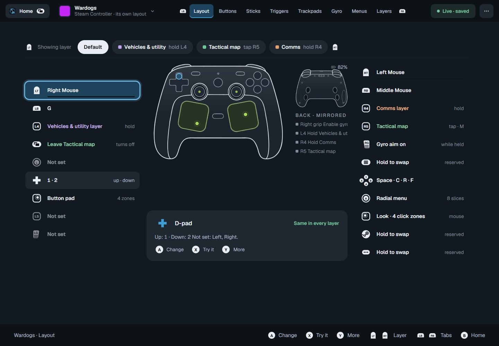
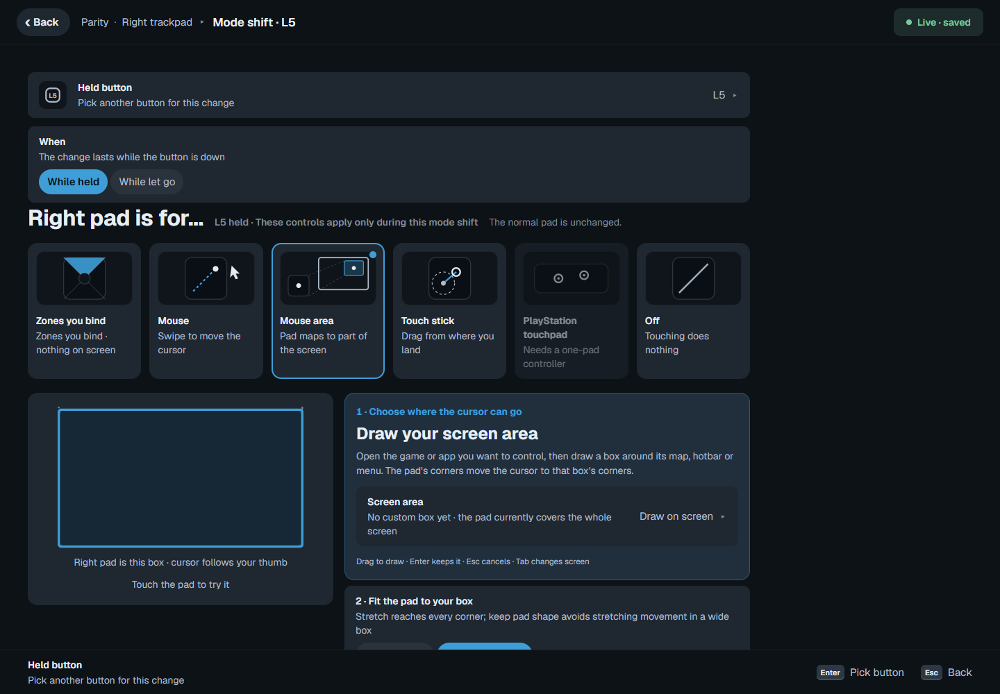
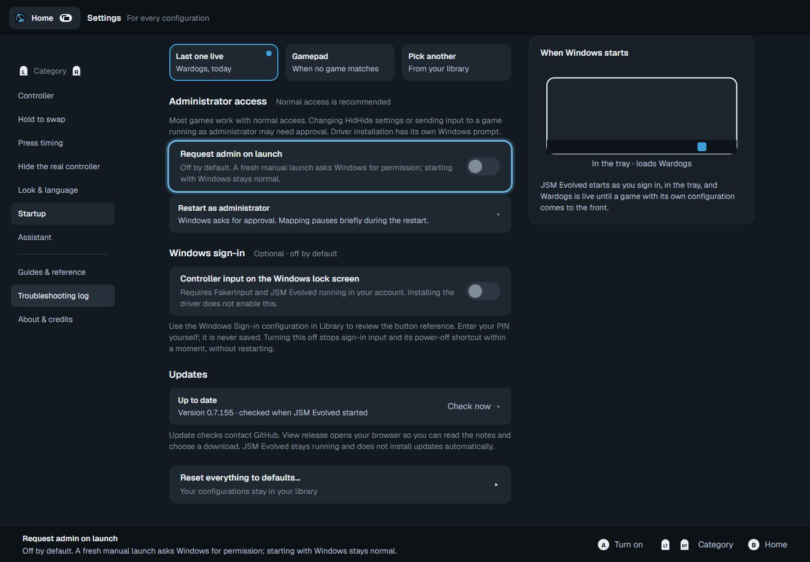

  

<h1 align="center">JSM Evolved</h1>

<strong>Make your controller feel right. Keep your JoyShockMapper configs.</strong> Gyro aiming, trackpad tuning and game profiles in a controller-friendly Windows app.

  <a href="#download--release-status">Download & release status</a> ·
  <a href="docs/getting-started.md">First setup</a> ·
  <a href="#why-use-this-instead-of-steam-input">Compare</a> ·
  <a href="docs/privacy-and-permissions.md">Permissions & privacy</a> ·
  <a href="https://github.com/LukeyBeachBoy/JSM_Studio/issues">Get help</a>

*The real editor renderer with a sample configuration. Screenshots illustrate the current candidate; they are not gameplay or hardware-test evidence.*

## What is it for?

JSM Evolved is a free, open-source desktop interface and bundled fork of **JoyShockMapper**. It is for people who want JSM's gyro and mapping controls, with a visual editor they can navigate from the couch.

Tune how aiming responds, put different actions on a tap or a hold, turn a trackpad into a menu, and keep a configuration for each game. Your mappings remain readable text files. Steam does not need to launch the game for JSM to map your controller.

**The motivation:** JSM offers a lot of control, but managing text commands, profiles and separate tools adds friction. This fork brings those controls into one app, with particular attention to Steam Controller trackpads, gyro tuning, overlays and controller navigation. It is an independent community project, not an official Valve product or the upstream JoyShockMapper release.

**Where it comes from:** Evolved builds on JSM Studio and the JSM Custom Curve line, which in turn build on JoyShockMapper. This fork focuses on the editing experience around that engine: tune a pad, give a held button its own layout, see which profile is live, and make changes without leaving the controller. The upstream authors and projects are credited below and inside the app.

## Download & release status

**Windows x64. Development software.**

[**Browse this project's Windows releases →**](https://github.com/LukeyBeachBoy/JSM_Studio/releases)

**Candidate: 0.7.155 · Windows x64 · unsigned.** See the [candidate notes and test status](docs/releases/0.7.155.md). This candidate is being prepared locally; it is not yet a public download.

As checked on **20 October 2026**, the newest public release is still **v0.7.22**, named *JSM Studio*. It predates the interface and permission changes shown here. **Do not download that older release expecting these features.**

Download the Windows `*-setup.exe` asset, not GitHub's “Source code” archive. Current packaging produces an NSIS installer; do not expect an MSI unless a particular release actually provides one.

- App installers are currently **unsigned**. Windows may show **Unknown publisher** or SmartScreen. A logo and publisher metadata do not authenticate a file.
- Normal app launches in the current source **do not request administrator access**. Driver setup and an explicit administrator restart can still prompt. Older releases behave differently.
- Controller input on the Windows lock screen is **off by default** and needs its own confirmation, even when FakerInput is already installed.
- **View release** opens GitHub in your browser. The app does not download or run an update installer.
- Linux, SteamOS and macOS builds of this desktop app are **not available**.
- Read [first setup](docs/getting-started.md) before installing drivers. Back up your configuration library before upgrading.

## What you can configure

| Area | What it gives you |
| --- | --- |
| Gyro aiming | Sensitivity, acceleration curves, smoothing, low-speed steadying, activation and click dampening |
| Sticks | Aim, flick stick, directional inputs, mouse regions and radial menus |
| Trackpads | Mouse, trackball, directional/grid regions, touch menus, per-pad controls and click dampening |
| Buttons & triggers | Keyboard, mouse and virtual gamepad outputs; tap, hold, double press, chords, toggle and turbo |
| Layers & mode shifts | Alternate bindings and settings while a condition is active |
| Game configurations | Library, per-game switching, shared bases and controller-specific layouts |
| Editing | Live tuning, change review, undo, and separate save/apply actions |
| Steam layout import | Review conversions and listed approximations/gaps before creating a configuration |
| On-screen controls | Virtual menus and controller-operated keyboard |
| Controller feedback | Supported-device haptics and sound controls |
| Optional assistant | Configuration suggestions using a provider you configure; manual editing needs no AI account |

Features depend on the physical controller, connection mode and selected output. A controller without a gyro cannot gain one through software.

### One pad, different jobs

Use a trackpad as a mouse, then hold a button to switch to another mode or a bounded screen area. The mode-shift editor exposes the same controls as the normal pad editor.

*Current editor with sample configuration data.*

### Permissions you choose

*Current renderer with sample data. Administrator launch and Windows sign-in input are separate choices.*

## Why use this instead of Steam Input?

**Keep using Steam Input if it already does what you need.** It has integrated game support and community layouts. Evolved is worth investigating if you specifically want JSM's configuration format and aiming controls, independent game launching, or this editor's trackpad and menu workflow.

This compares workflows, not performance. ☑️ = available; ◐ = limited, different or conditional; ❌ = not provided by that product. Evolved means the **0.7.155 candidate source**, not v0.7.22. Upstream means the JoyShockMapper command-line application without a separate GUI.

| Capability | JSM Evolved | Steam Input | Upstream JSM |
| --- | :---: | :---: | :---: |
| Gyro-to-mouse on supported hardware | ☑️ | ☑️ | ☑️ |
| Keyboard and mouse mappings | ☑️ | ☑️ | ☑️ |
| Virtual gamepad output | ◐ Driver required | ☑️ | ◐ Driver/platform dependent |
| Chords / alternate bindings | ☑️ | ☑️ | ☑️ |
| Tap, hold and double-press bindings | ☑️ | ☑️ | ☑️ |
| Toggle and repeated actions | ☑️ | ☑️ | ☑️ |
| Visual configuration editor included | ☑️ | ☑️ | ❌ |
| Controller navigation of included editor | ☑️ | ☑️ | ❌ |
| Editable JSM text profiles | ☑️ | ❌ Different format | ☑️ |
| Mapping without the Steam client | ☑️ | ❌ | ☑️ |
| Per-game configuration selection | ☑️ | ☑️ | ☑️ |
| On-screen radial / touch menus included | ☑️ | ☑️ | ❌ |
| Built-in Steam community layout browser | ❌ | ☑️ | ❌ |
| Import locally saved Steam layouts | ◐ Conversion review | ☑️ Native format | ❌ |
| Game-native Steam Input API actions | ❌ | ☑️ Supported games | ❌ |
| Source available to inspect and modify | ☑️ | ❌ | ☑️ |
| This application on Linux / SteamOS | ❌ | ☑️ | ◐ See upstream support |

Sources: [Valve's Steam Input documentation](https://partner.steamgames.com/doc/features/steam_controller), [upstream JoyShockMapper](https://github.com/JibbSmart/JoyShockMapper), and [Evolved's Steam import scope](docs/steam-layout-import.md). Sources revisited 20 October 2026. Different gyro algorithms and sensitivities are not interchangeable. No latency advantage or complete Steam Input parity is claimed.

**Already using reWASD or DS4Windows?** The reason to try Evolved is its JSM engine, text-profile workflow and editor. There is no completed feature audit of those applications here, so this table does not assign speculative crosses. Try one mapper at a time when diagnosing doubled input.

## Controller and game compatibility

| Hardware / environment | Current position |
| --- | --- |
| Steam Controller 2026 | Main focus of this fork; per-pad, grip and haptic work. Connection-by-connection acceptance testing is still needed for the next release. |
| DualShock 4, DualSense, Joy-Con, Switch Pro | Supported JSM families with editor handling. This does not mean every feature and transport was tested in the next release. |
| Xbox and other SDL controllers | Depends on exposed inputs. Extra buttons, gyro and haptics vary by model, mode and driver. |
| Steam Controller 2015 | Do not infer support from the 2026 name. Dedicated release validation is pending. |
| Steam Deck / Linux / macOS | No supported Evolved desktop build. See Steam Input or upstream JSM for their platform support. |
| Games mixing mouse and gamepad | Game dependent; some switch prompts or reject simultaneous inputs. |
| Anti-cheat / competitive games | No universal compatibility or ban-safety guarantee. Check the game's rules and reports. |

For a useful report, include your controller model, USB/Bluetooth/receiver mode, Windows version, app version, output mode and game. [Report an issue](https://github.com/LukeyBeachBoy/JSM_Studio/issues/new/choose).

## Questions before installing

**“Why does it need admin?”**

Ordinary editing and input to ordinary applications do not require it. Windows restricts synthetic input to applications at the same or lower privilege level. Some HidHide operations and driver installation need elevation. The new default is normal access, with **Settings → Startup → Restart as administrator** and an optional launch preference. [Details](docs/privacy-and-permissions.md).

**“Is this safe? Why is the publisher unknown?”**

Inspectable source and build instructions are not a security audit or proof that any binary is harmless. App binaries are unsigned. Use this repository's releases, check the version and published hash when provided, and do not disable Windows protection to install it. Code signing and clean-machine testing remain release work. [Component inventory](docs/privacy-and-permissions.md).

**“Are you installing drivers?”**

ViGEmBus is for virtual gamepad output, HidHide hides the physical controller, and FakerInput is an optional virtual keyboard/mouse path. They are separate from ordinary keyboard/mouse mapping. Current installer changes make ViGEmBus and FakerInput opt-in; HidHide has a separate setup flow. Shared drivers remain after app uninstall. ViGEmBus is [end-of-life upstream](https://docs.nefarius.at/projects/ViGEm/End-of-Life/), a real maintenance limitation.

**“Is this an AI wrapper?”**

Mapping runs through JoyShockMapper. An optional assistant can send your request, conversation context and configuration to your chosen provider; the editor and mapper work without it. AI tools have also been used during development. Judge the implementation, test evidence and limitations here; AI involvement is not a substitute for hardware validation. [Data handling](docs/privacy-and-permissions.md).

**“Can I reuse my Steam or JSM setup?”**

JSM text profiles are the native starting point. Steam import creates a conversion with a review of approximations and unsupported actions. Keep the original and test important bindings; lossless compatibility is not promised.

**“Does it phone home?”**

Controller telemetry stays on local loopback. Startup update checks contact GitHub; opening online links and explicitly using an external assistant also use the network. Core mapping does not require an online account. See the [network and storage inventory](docs/privacy-and-permissions.md).

## Where this came from

The lineage matters: **Julian “Jibb” Smart's JoyShockMapper → Electronicks' continued development → Evan McLean's Custom Curve work → Hotuns' JSM Studio → Luke Beach's JSM Evolved fork.** This project builds on those contributions; gyro aiming and flick stick are not new inventions of Evolved.

This repository maintains the app. Its pinned [JoyShockMapper submodule](https://github.com/LukeyBeachBoy/JoyShockMapper) contains this fork's engine changes. See [credits and attribution](docs/CREDITS.md) and the [MIT license](LICENSE.md); dependencies keep their own licenses. The old repository name remains for continuity.

## Help, contribute or build it yourself

- [Bug reports and feature requests](https://github.com/LukeyBeachBoy/JSM_Studio/issues/new/choose): include a small reproduction and version.
- [Build a Windows installer](docs/building-installer.md): source, prerequisites and packaging.
- [Release readiness](docs/release-readiness.md): remaining checks before the public introduction.
- [简体中文说明](README_zh.md).

Review logs and configuration files for personal paths, credentials or private bindings before sharing them.
